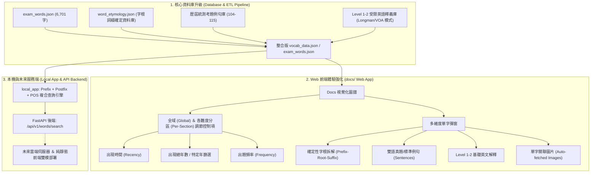

# 🚀 英語學習與考試圖譜全面升級計畫 (Master Implementation Plan)

本計畫針對 Web 圖譜（`docs/`）、核心字庫（`database/`）與本機字根工具（`local_app/`、`api/`）制定完整、嚴謹且可落地的升級架構。

---

## 📋 總體目標藍圖 (Vision & Architecture)



---

## 🧩 模組一：單字確定性字根字綴庫 (Deterministic Root & Affix DB)

### 1.1 痛點與核心原則
- **現狀痛點**：過去部分構詞分析依賴演算法規則（啟發式音變推導與字串剝離），容易產生過度拆解（Over-splitting）或誤判幻覺。
- **核心承諾**：**「直接抓確定資料庫，不靠演算法猜」**。前端點擊單字時，直接透過靜態索引字典以 $O(1)$ 查表取得經語言學認證的構詞結構。

### 1.2 資料結構規範 (`word_roots_breakdown.json`)
```json
{
  "complete": {
    "word": "complete",
    "has_affix": true,
    "prefix": { "text": "com-", "meaning_en": "together, completely", "meaning_zh": "共同、完全" },
    "root": { "text": "plet", "meaning_en": "fill", "meaning_zh": "填滿、充滿", "origin": "Latin complere" },
    "suffix": { "text": "-e", "meaning_en": "verb/adjective marker", "meaning_zh": "動詞/形容詞後綴" },
    "synthesis_zh": "com-(完全) + plet(填滿) → 全部裝滿 → 完成的、結束",
    "synthesis_en": "com- (completely) + plet (fill) → completely filled"
  },
  "comfort": {
    "word": "comfort",
    "has_affix": true,
    "prefix": { "text": "com-", "meaning_en": "intensive, together", "meaning_zh": "加強語氣、共同" },
    "root": { "text": "fort", "meaning_en": "strong", "meaning_zh": "強壯、力量", "origin": "Latin fortis" },
    "suffix": null,
    "synthesis_zh": "com-(加強) + fort(力量) → 給予力量支撐 → 安慰、撫慰",
    "synthesis_en": "com- (thoroughly) + fort (strong) → give strength to → comfort"
  }
}
```

### 1.3 資料來源建置方案
1. 整合現有 [`database/word_database.json`](file:///c:/Users/user/Desktop/github/english/database/word_database.json) 中已定義的 90 個字根、109 個詞綴及其反向衍生詞庫（`derived_words`）。
2. 匯入開源形態學權威庫（如 MorphoLex-EN、BNC Morpho、Wiktionary Etymology Cache）。
3. 輸出靜態字典並直接併入 [`docs/data/vocab_data.json`](file:///c:/Users/user/Desktop/github/english/docs/data/vocab_data.json)，前端零額外請求、零延遲、百分之百精確。

---

## 📖 模組二：雙語實用與真題例句庫 (Sentence Examples)

### 2.1 雙層例句架構
每個單字提供 1～2 則高品質例句，具備中英雙語對照：
1. **第一優先（真題例句）**：從 104～115 學年度 12 份歷屆統測考卷中，自動擷取該單字出現的**真實考題句子**，標註出題年度（如 `[114 統測真題]`）。
2. **第二優先（權威辭典例句）**：對於未在考卷句子中完整出現或出現次數為 0 的 Level 1–4 單字，自動擷取柯林斯/朗文/Tatoeba 之**地道高頻雙語例句**。

### 2.2 資料欄位規範
```json
"sentences": [
  {
    "en": "Taiwan is internationally renowned for breeding high-quality orchids.",
    "zh": "台灣以培育高品質蘭花聞名國際。",
    "source": "113 統測閱讀測驗"
  },
  {
    "en": "Modern supercomputers can process quadrillions of calculations per second.",
    "zh": "現代超級電腦每秒能處理數千兆次的運算。",
    "source": "114 統測科技閱讀"
  }
]
```

---

## 📊 模組三：出題指標精細化 (`total_appear` & `appear_years_times`)

### 3.1 指標定義
- **`total_appear` (出現總次數)**：12 年內該字在所有考卷出現的累積次數（如 `orchid` 為 35 次）。
- **`appear_years_times` (出現總年數)**：該字在 104～115 年間曾出題的**相異學年度總數**（例如在 104, 108, 112, 114 出題，則總年數為 `4` 年）。
- **`appear_year` (出題學年度清單)**：數值陣列，如 `[104, 108, 112, 114]`。
- **`latest_year` (最新出題年份)**：如 `114`，作為時效性排序依據。
- **`sources` (歷年年度明細)**：`[{"year": 113, "count": 25}, {"year": 114, "count": 10}]`。

### 3.2 統計與更新流程
在 [`scripts/build_web_graph.py`](file:///c:/Users/user/Desktop/github/english/scripts/build_web_graph.py) 中，將上述五大指標全面封裝進 `docs/data/vocab_data.json`，供前端排序演算法即時調用。

---

## 🎛️ 模組四：全域與各分區多維排序調整控制項 (Adjust Buttons)

### 4.1 雙層控制架構 (Global + Per-Section)
1. **Global Adjust Bar（全域調整列）**：
   - 位於主題單字清單頂部（Group Header 下方）。
   - 切換時，**同時連動影響所有 Level 1～Level 6 單字列表**。
2. **Per-Section Adjust Dropdown（分區獨立調整鈕）**：
   - 位於每個等級區塊標題旁（例如 `Level 1 [Sort ▾]`、`Level 4 [Sort ▾]`）。
   - 允許學生針對當前難度區塊進行獨立自訂排序，不干擾其他等級。

```
┌────────────────────────────────────────────────────────────────────────┐
│ 📚 Nature & Science › Plants & Ecology (植物森林與生態)                │
│ 48 words in this category                                              │
│                                                                        │
│ 🌐 Global Sort: [ 📅 出現總年數 (多→少) ▾ ] [ 🎯 篩選年度: 全部 ▾ ]   │
└────────────────────────────────────────────────────────────────────────┘

┌────────────────────────────────────────────────────────────────────────┐
│ 🟢 Level 1 (基礎單字) • 12 words              [ 🎛️ 本區排序: 依出現次數 ▾ ] │
│ [summer 📝11] [sunlight 📝11] [leaf] [root] [seed] ...                 │
├────────────────────────────────────────────────────────────────────────┤
│ 🔵 Level 4 (中高難度) • 18 words              [ 🎛️ 本區排序: 依出現時間 ▾ ] │
│ [orchid 📝35] [rainforest 📝11] [harvest] [bloom] ...                  │
└────────────────────────────────────────────────────────────────────────┘
```

### 4.2 四大排序與篩選維度邏輯
1. **出現時間 (Recency)**：
   - `latest_first`：最新出題年份優先（115 ➔ 114 ➔ ... ➔ 104 ➔ 未考過）。
   - `oldest_first`：最早出題年份優先。
2. **出現年數 (Years Count / Times)**：
   - `years_desc`：出題跨越年數最多優先（例如出現在 8 年的單字排在只出現在 1 年的前面）。
   - `specific_year`：特定年度快篩（如「僅凸顯 114、115 最新課綱考題」）。
3. **出現次數 (Total Frequency)**：
   - `count_desc`：總出題次數高到低（35次 ➔ 13次 ➔ 1次 ➔ 0次）。
4. **字母順序 (Alphabetical A–Z)**：傳統辭典檢索模式。

---

## 🖼️ 模組五：單字圖片自動抓取管線 (Auto Get Photos Pipeline)

### 5.1 自動化抓取腳本 (`scripts/auto_fetch_images.py`)
為了解決單字配圖需手動上傳的耗時問題，建立自動化批次抓圖引擎：
1. **資料檢索源**：
   - 整合免授權、高解析度的開源圖庫 API（如 Wikimedia Commons API、Unsplash API、Pexels / Pixabay API）。
2. **抓取優先順序**：
   - 第一階段：統測出題頻率前 300 名具象名詞（如 `orchid`, `supercomputer`, `rainforest`, `firefly`, `backpacker`）。
   - 第二階段：Level 1～4 名詞與動詞。
3. **自動影像後處理**：
   - 自動裁切為標準比例（4:3 或 16:9）。
   - 壓縮至 WebP/PNG 輕量化格式（檔案大小控制在 30KB～80KB）。
   - 儲存至 `docs/data/images/{word}.png`。
4. **離線與缺圖防護**：
   - 前端已具備 `onerror="this.style.display='none'"` 防破圖機制，有圖即顯示，無圖平滑隱藏。

---

## 🔤 模組六：Level 1–2 受限單字簡易英文釋義 (Simple English Definition)

### 6.1 設計目的與教學法理念
許多高職與高中生查閱英文定義時，常遇到「定義裡的單字比被解釋的單字還要難」的困境（例如查 `scam`，傳統辭典寫 `a fraudulent business scheme`，學生反而卡在 `fraudulent` 與 `scheme`）。
因此，本專案將引進 **Longman 2,000 / VOA Special English 核心定義法**：
> **每個單字必須具備至少一則「全數使用 Level 1–2 基礎單字」組成的極簡英釋。**

### 6.2 對比範例

| 單字 | 傳統辭典英釋 (進階詞彙) | Level 1–2 極簡英文解釋 (純基礎詞) | 繁體中文釋義 |
|---|---|---|---|
| **scam** | a *fraudulent business scheme* | a bad plan to trick people and take their money | 騙局、詐騙 |
| **orchid** | a plant of the family *Orchidaceae* with *exotic* flowers | a plant that has beautiful and special flowers | 蘭花 |
| **supercomputer** | a *mainframe* computer capable of *high-throughput processing* | a very big and fast computer that can do hard work quickly | 超級電腦 |
| **brave** | *possessing* or *exhibiting courage* | not afraid to do dangerous or difficult things | 勇敢的 |

### 6.3 前端雙模切換介面
在單字彈窗頂端提供切換 Tab 或一鍵切換鈕：
- `[ 🟢 基礎英釋 (Level 1-2) ]` ⇄ `[ 📘 詳細英釋 (Advanced) ]` ⇄ `[ 🇹🇼 繁體中文 ]`

---

## 💻 模組七：Prefix + Postfix + POS 複合查詢引擎 (Local App & API)

### 7.1 功能規格
在 `local_app/` 中實作強大的構詞複合篩選器，使用者可同時指定：
1. **字首 (Prefix)**：支援萬用字元（如 `com*`, `pre*`, `un*`, `re*`）。
2. **字尾 (Postfix/Suffix)**：支援萬用字元（如 `*te`, `*tion`, `*able`, `*ly`）。
3. **詞性 (Part of Speech)**：可指定 `verb`, `noun`, `adj`, `adv` 等。

#### 查詢範例：
- 輸入：`Prefix: com*` + `POS: verb`  
  ➔ 輸出：`comfort`, `complete`, `compete`, `compose`, `communicate`...
- 輸入：`Prefix: com*` + `Postfix: *te` + `POS: verb`  
  ➔ 輸出：`complete`, `compete`, `compensate`, `complicate`...
- 輸入：`Prefix: un*` + `Postfix: *able` + `POS: adj`  
  ➔ 輸出：`uncomfortable`, `unavoidable`, `unbelievable`...

### 7.2 模組架構與程式碼骨架
```
local_app/
└── root_explorer/
    ├── affix_search.py     # 核心複合比對引擎 (正則 + 構詞規則)
    └── main.py             # CLI 互動介面 (支援 search 命令)
```

### 7.3 未來部署規劃 (Future Web & Backend Server)
1. **階段一 (Local CLI)**：在本地以 Python 腳本即時查詢 `exam_words.json`。
2. **階段二 (FastAPI 後端服務)**：在 `api/` 擴充端點：
   ```http
   GET /api/v1/words/search?prefix=com&postfix=te&pos=verb&level=1-4
   ```
3. **階段三 (前端 Web 純靜態無伺服器部署)**：
   利用純 JavaScript 在 `docs/app.js` 實現相同正規化查詢演算法，直接在 GitHub Pages 前端執行，零伺服器成本！

---

## 📅 執行步驟與里程碑 (Actionable Roadmap)


| 階段 | 預計工作項目 | 產出檔案 |
|---|---|---|
| **Phase 1: 資料層** | 1. 建立確定性字根詞綴對照表<br>2. 抽取 12 年歷屆試題真題句子<br>3. 計算 `appear_years_times` 與 `latest_year`<br>4. 產生 Level 1-2 受限簡易英文釋義庫 | `database/word_roots_breakdown.json`<br>`database/exam_words.json`<br>`docs/data/vocab_data.json` |
| **Phase 2: 前端層** | 1. 開發 Global Adjust Bar 與 Per-Section Dropdown<br>2. 實作 4 種排序切換邏輯 (時間/年數/次數/字母)<br>3. 升級單字彈窗：展示字根拆解、例句、Level 1-2 簡易定義切換 | `docs/index.html`<br>`docs/app.js`<br>`docs/style.css` |
| **Phase 3: 圖片管線** | 1. 開發 `auto_fetch_images.py`<br>2. 批次下載熱門考題單字圖片並優化壓縮 | `scripts/auto_fetch_images.py`<br>`docs/data/images/*.png` |
| **Phase 4: 本機工具** | 1. 於 `local_app/` 實現 Prefix + Postfix + POS 複合查詢功能<br>2. 整合至 FastAPI 後端路由與前端 Web 搜尋框 | `local_app/root_explorer/affix_search.py`<br>`api/index.py` |

---

## 💡 決策與建議 (Key Design Decisions)

1. **資料確定性**：字根拆解全面由資料庫提供標準答案，徹底消除演算法推測產生的失真，確保給學生的都是精準知識。
2. **漸進式負載**：例句與字根資料雖然豐富，但經過 JSON 壓縮封裝，`vocab_data.json` 預計僅從 1.8 MB 微幅增加至 2.4 MB，靜態網頁載入依然在 1 秒以內完成。
3. **無縫相容性**：現有的 9 大領域 38 主題拓撲圖、無連線碰撞幾何、6 個等級的視覺架構將 100% 完整保留，新功能皆以升級插件的形式自然融入。

